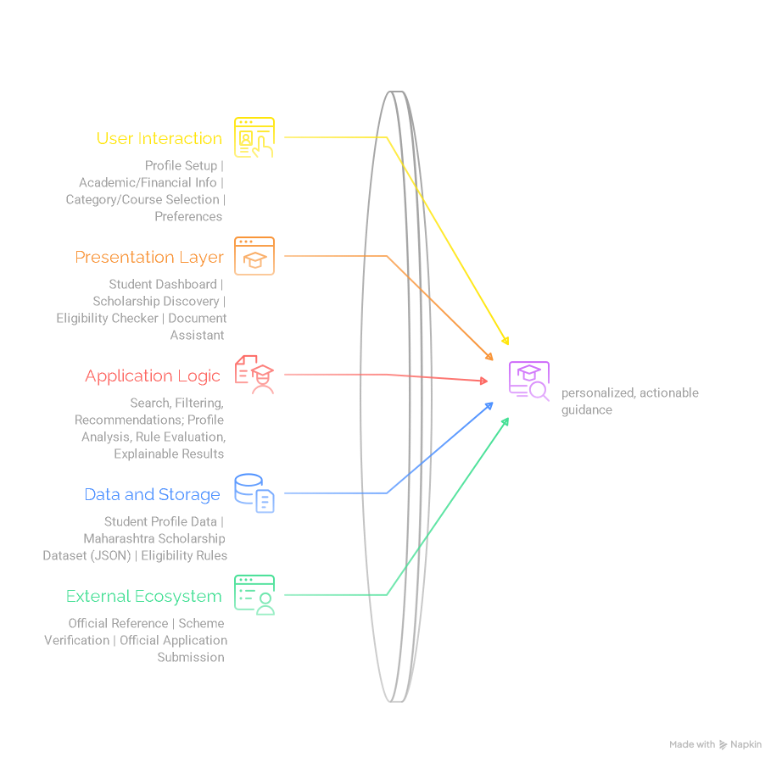
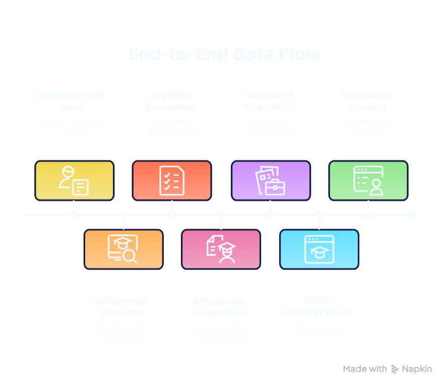
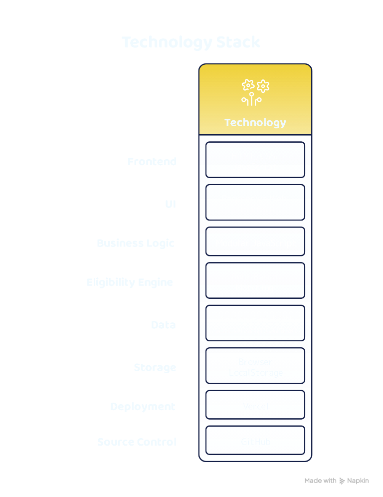

# VIDVATTA Architecture

VIDVATTA is a static, browser-based scholarship guidance application for
students in Maharashtra. It uses the MahaDBT ecosystem as its primary
reference, but is independently operated: it has no government connection,
backend, live MahaDBT integration, or application-submission service.

The diagrams below were supplied for this project and are included unchanged.
The notes in this document describe the implemented application; where a
diagram is conceptual or broader than the current code, that distinction is
called out.

## Guidance architecture



The implemented browser architecture has four cooperating areas:

1. **User interaction — `index.html`**: student profile, discovery filters,
   eligibility answers, document checklists, tracker stages, reminders, and
   comparison controls.
2. **Presentation — `style.css` and `script.js`**: responsive page layout,
   accessible controls, DOM rendering, and interaction handling.
3. **Application logic — `eligibility-rules.js` and `script.js`**:
   conservative rule matching, condition classification, fee-component
   estimates, input validation, roadmap progress, and workspace updates.
4. **Data and storage — `scheme-catalog.js` and
   `local-profile-storage.js`**: a curated static scheme catalogue and
   browser-local profile/workspace persistence.

MahaDBT is the external reference ecosystem. VIDVATTA links students to
official directories and application pages; it does not fetch private portal
data, authenticate users with MahaDBT, or submit forms there.

## End-to-end student journey



The journey represented in the application is:

1. **Profile input** — optional profile details are saved locally in the
   student's browser. Eligibility uses an income range rather than an exact
   family income amount.
2. **Scholarship discovery** — search and category/study-level filters operate
   on the local, curated catalogue.
3. **Eligibility assessment** — a reusable rules module checks only the two
   implemented rule sets. It reports passed, failed, and unverified criteria;
   it does not estimate approval probability.
4. **Document preparation** — the checklist stores self-reported completion
   marks only. No documents, document numbers, or document metadata are
   uploaded or saved.
5. **Official portal navigation** — the student follows an external MahaDBT
   link to confirm current requirements and submit an application.
6. **Application tracking** — the student manually updates local pipeline
   stages, notes, deadlines, and reminders. No status is read from MahaDBT
   and no notifications are sent.

The diagram is a journey model, not an integration diagram. The official
portal is an external destination; no data is exchanged between MahaDBT and
VIDVATTA.

## Technology stack



| Layer | Implementation | Responsibility |
| --- | --- | --- |
| Markup and UI | HTML in `index.html` | Semantic page structure, forms, navigation, and live-result regions |
| Styling | CSS in `style.css` | Brand styles, responsive layouts, visible focus, and reduced-motion behavior |
| Application | Vanilla JavaScript in `script.js` | DOM events, discovery filters, rendering, form validation, and roadmap updates |
| Scheme data | `scheme-catalog.js` | Curated static school and college listings |
| Eligibility service | `eligibility-rules.js` | Explainable matching, checks, and supported fee estimates; also exports Node-testable functions |
| Persistence service | `local-profile-storage.js` | Read, write, and delete operations for the browser-local profile |
| Browser persistence | `localStorage` | Profile, eligibility answers, checklist marks, tracker entries, and reminders on this device |
| Hosting | Static Vercel deployment | Serves HTML, CSS, JavaScript, and image assets; no build step or server functions |
| Source control | GitHub | Stores the project source and documentation |

There is no React runtime, API server, database, external AI service, or
authentication provider. The local profile is not a secure account and does
not synchronize between devices.

## Runtime and data flow

```text
Browser interaction
        |
        +--> scheme-catalog.js --> search / category / level filtering
        |
        +--> eligibility-rules.js --> assessment --> explanation in UI
        |                                 |
        |                                 +--> supported SEBC fee estimate
        |
        +--> local-profile-storage.js <--> browser localStorage
        |                                    profile, answers, check marks,
        |                                    manual tracker, reminders
        |
        +--> outbound official link --> MahaDBT (external; no data exchange)
```

`script.js` connects these modules to the page. Dynamic user-provided text is
rendered with text nodes or `textContent`, rather than interpolated as HTML.
Storage errors are reported in the interface instead of being treated as
successful writes.

## Eligibility and benefit boundaries

- The screener currently represents ST vocational training fee reimbursement
  and SEBC technical education tuition fee scholarship rules.
- Unknown or overlapping income ranges remain unverified. A possible match
  means only that the represented checks did not fail or remain unknown.
- The fee calculator estimates only the represented SEBC tuition and
  examination-fee components when all represented checks pass. It does not
  calculate other fee components, maintenance support, or an approved award.
- The scheme catalogue is curated and static. It is not complete or guaranteed
  to reflect current availability.
- MahaDBT remains authoritative for current requirements, dates, eligibility,
  documents, fee calculations, applications, and decisions.

## Quality and testing

Automated checks are defined in `tests/` and run with `npm test`:

- Node unit tests cover rule outcomes, income boundaries, fee estimates, and
  browser-storage failures.
- Playwright browser tests cover page initialization, discovery, eligibility,
  persistence, the application pipeline, reminders, comparison, language
  guidance, accessibility labels, keyboard navigation, and responsive layouts.

These tests verify the local interface and logic; they do not verify
government systems, scholarship decisions, or a Lighthouse score.

## Related documentation

See [README.md](./README.md) for product scope, problem mapping, setup,
testing, deployment, and project limitations.
